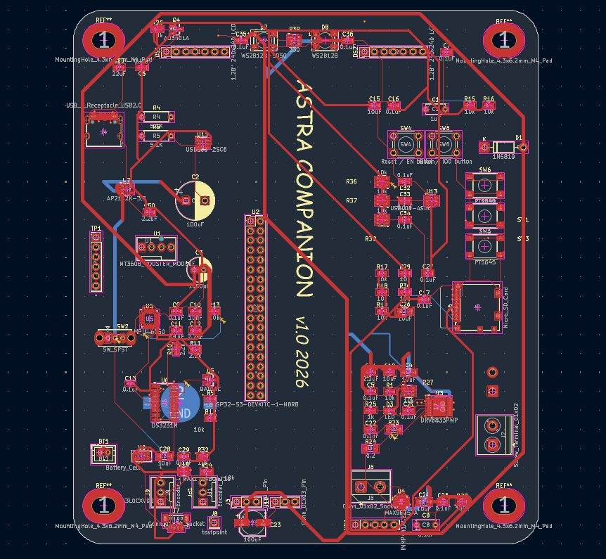
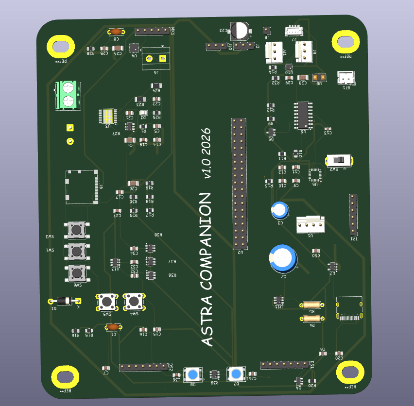
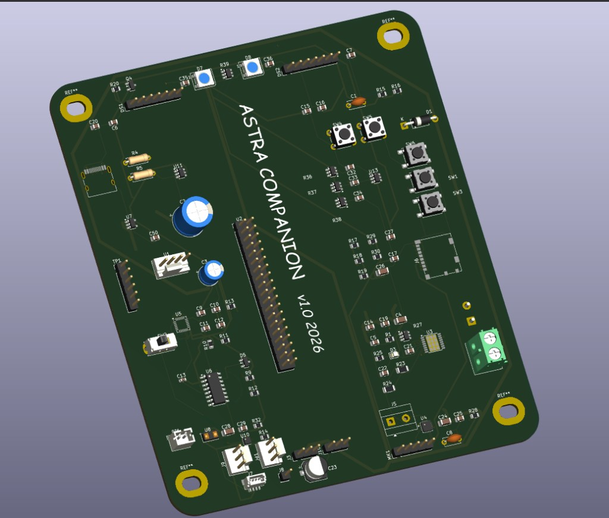
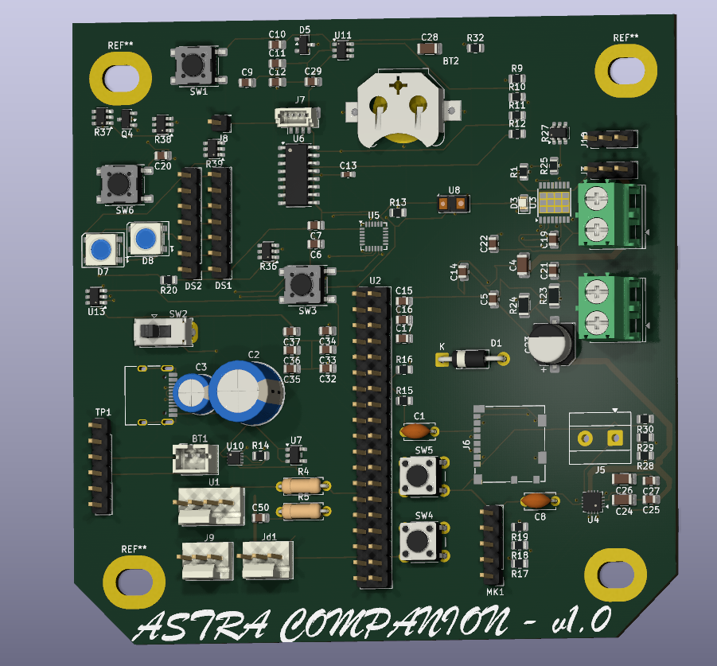
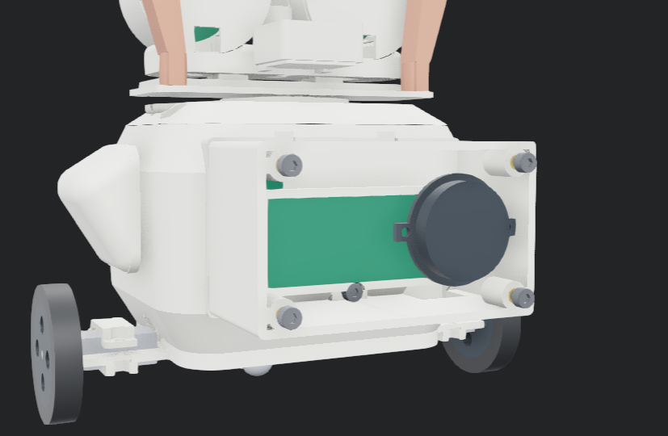

# Astra Companion: audio module and carrier PCB

This repo is the **audio and noise week** slice of [Astra Companion](https://github.com/atireksd11/Astra-Companion). It has the printed body audio box and neck pivot parts list, the KiCad schematic and PCB (mic, amp, and the rest of the carrier), and the docs that go with listening and denoise on the robot.

The full plastic chassis is in [Astra-Companion-Cad](https://github.com/atireksd11/Astra-Companion-Cad). The laptop voice bridge and server live in the main repo.

Mic and speaker electronics on the board: **INMP441** and **MAX98357A** on the ESP32-S3 carrier. The mechanical module adds a side speaker panel, **608-ZZ** neck bearings, and **MG90S** head pan.

**PCB status:** layout is in the repo but **not fab ready yet**. Do not order boards until routing and DRC are clean.

## Carrier PCB (KiCad 10)

Open [hardware/astracompanion/](hardware/astracompanion/). Grant parts list: [hardware/bom.csv](hardware/bom.csv). Schematic reference: [hardware/BOM2.md](hardware/BOM2.md).









## Audio module and neck (mechanical)

**$27.94** in parts before tax and shipping. Unit price is per piece. The totals are the pack prices Amazon charges. Details: [hardware/BOM_AUDIO_MODULE.md](hardware/BOM_AUDIO_MODULE.md). CSV for grants: [hardware/bom-audio-module.csv](hardware/bom-audio-module.csv).

| Part | Qty | Unit | Total | Where |
|------|-----|------|-------|-------|
| [PGN 608-ZZ ball bearings, 10 pack](https://www.amazon.ca/gp/product/B07XLV1W2M/ref=ox_sc_act_title_2?smid=A3RMJZMAP3U4RK&psc=1) (8 by 22 by 7 mm) | 10 | $1.30 | $12.95 | Amazon.ca |
| [MG90S metal gear micro servo, 2 pack](https://www.amazon.ca/gp/product/B0BHYHKF2P/ref=ox_sc_act_title_1?smid=A1AEYBYG92X8UY&psc=1) | 2 | $7.50 | $14.99 | Amazon.ca |
| Tax and shipping | | | about $5 | Prime / domestic |





## Docs in this repo

| File | What it covers |
|------|----------------|
| [docs/AUDIO.md](docs/AUDIO.md) | Robot ↔ laptop audio protocol and firmware modules |
| [docs/VOICE_SETUP.md](docs/VOICE_SETUP.md) | Laptop wake word, STT, and bridge setup |
| [docs/ROADMAP_AUDIO.md](docs/ROADMAP_AUDIO.md) | Sixteen feature roadmap order |
| [docs/FEATURE4_NOISE.md](docs/FEATURE4_NOISE.md) | Noise floor and denoise on the bridge |
| [docs/FEATURE3_DOA.md](docs/FEATURE3_DOA.md) | Direction of arrival (stereo mic path) |
| [docs/PINOUT.md](docs/PINOUT.md) | ESP32 GPIO map including I2S audio |

## Firmware

PlatformIO project in [firmware/](firmware/) (Arduino ESP32, C++). It covers balance, eyes, I2S mic and speaker, the voice listener, and Wi-Fi to the laptop bridge. There is no single `.ino` sketch. `src/main.cpp` is the entry point.

Build and flash from the `firmware` folder with PlatformIO:

```bash
pio run
pio run -t upload
pio device monitor
```

Copy `firmware/include/secrets.h.example` to `secrets.h` and put your Wi-Fi and bridge token there. `secrets.h` is gitignored so passwords stay off GitHub.

More detail: [firmware/README.md](firmware/README.md).

## Folder layout

```text
hardware/astracompanion/   KiCad schematic and PCB
hardware/bom.csv           PCB grant import
hardware/bom-audio-module.csv   Neck and speaker box grant import
hardware/BOM_AUDIO_MODULE.md    Mechanical BOM and CAD captions
docs/images/               PCB renders and audio module CAD shots
docs/                      Audio and voice design notes
```
